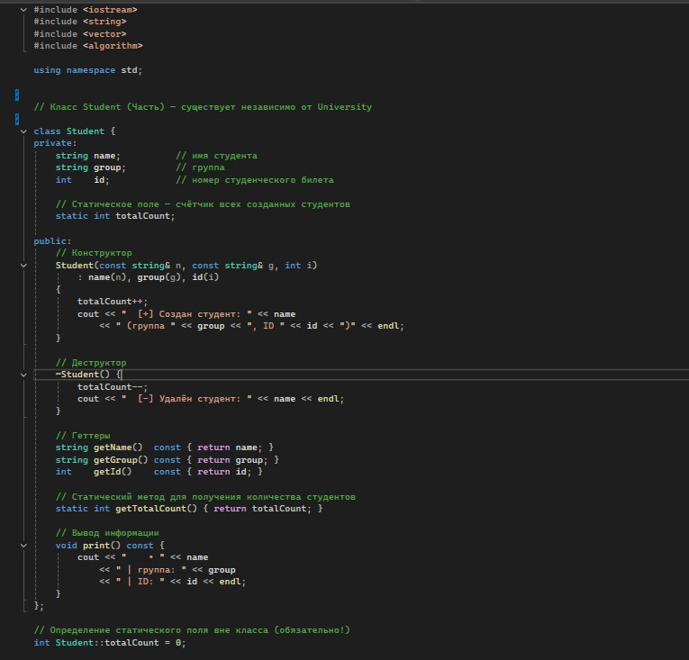
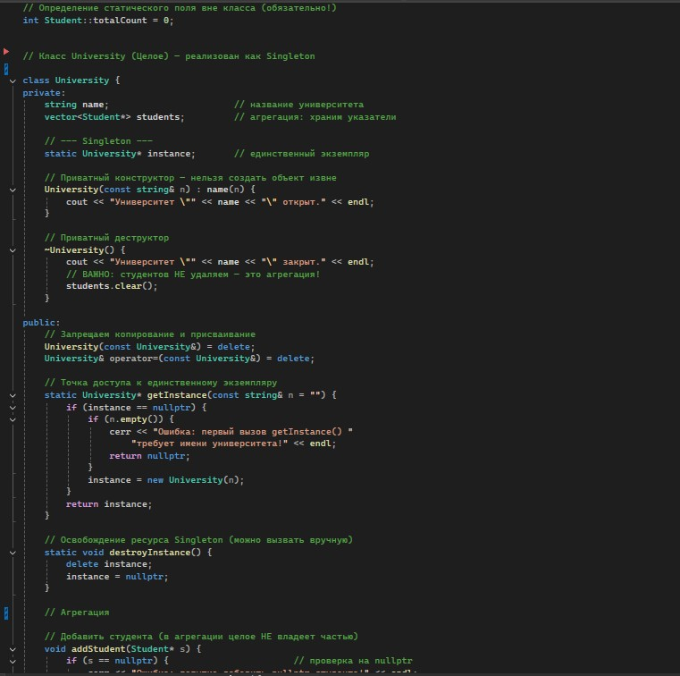
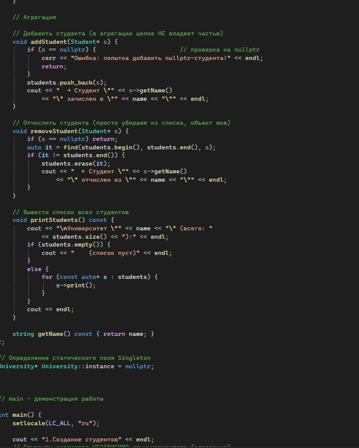
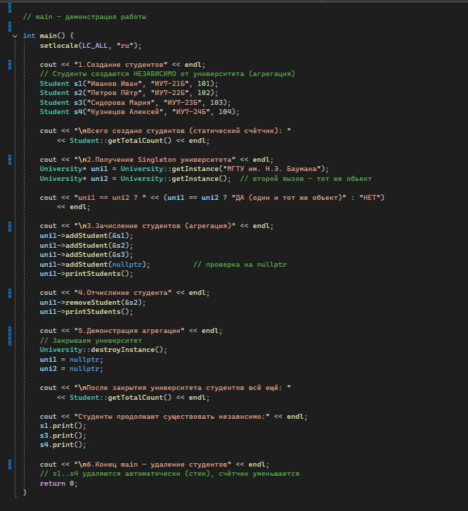
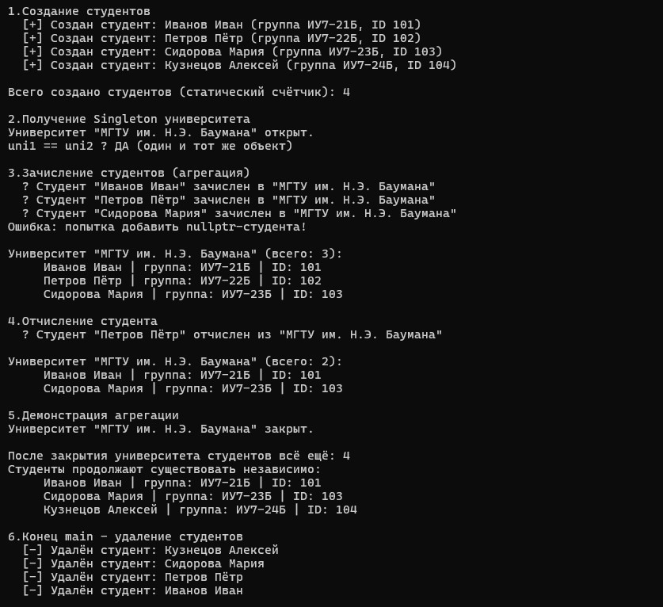

# Лабораторная работа №1
## Отношения между классами: композиция, агрегация. Статические члены класса. Паттерн Singleton.

**Выполнила:** *[Агафонова Софья Сергеевна]*  
**Группа:** *[ПИЖ-б-о-25-1]*  
**Вариант:** 1 (Продвинутый уровень)

---

## 1. Цель работы

1. Научиться проектировать отношения между классами: композицию, агрегацию и ассоциацию.
2. Освоить реализацию композиции (поля-объекты, вложение структур) и агрегации (указатели, ссылки).
3. Понять разницу между композицией и агрегацией с точки зрения времени жизни объектов.
4. Научиться использовать статические поля и методы для подсчёта объектов и реализации общих данных для всех экземпляров класса.
5. Получить навыки правильного управления памятью при разных типах отношений между классами.

---

## 2. Теоретическая часть

**Композиция** — это строгое отношение «часть–целое», при котором части не могут существовать отдельно от целого. Целое полностью управляет жизненным циклом своих частей: создает их при своем создании и уничтожает при своем разрушении. В C++ композиция реализуется через обычные поля-объекты или умные указатели (`std::unique_ptr`).

**Агрегация** — это более слабое отношение «часть–целое», при котором части могут существовать независимо от целого. Целое не несет ответственности за создание и удаление частей, а лишь хранит на них ссылки или указатели. При уничтожении агрегирующего объекта сами части не удаляются. В C++ реализуется через сырые указатели или ссылки.

**Статические члены класса** — это поля и методы, которые принадлежат не конкретному объекту, а всему классу целиком. 
* *Статическое поле* существует в единственном экземпляре в статической области памяти и является общим для всех объектов класса. Его часто используют как счетчик созданных объектов.
* *Статический метод* можно вызывать без создания экземпляра класса (через `ИмяКласса::метод()`). Он не имеет доступа к нестатическим полям, так как не привязан к конкретному объекту (не имеет указателя `this`).

**Паттерн «Одиночка» (Singleton)** — порождающий паттерн проектирования, гарантирующий, что у класса будет создан только один экземпляр, и предоставляющий глобальную точку доступа к нему. Для реализации используются: приватный конструктор, статический указатель на экземпляр и статический метод `getInstance()`.

---

## 3. Постановка задачи

**Вариант 1. Система учёта студентов.**
**Общее задание:**
1. Реализовать класс `Student` (студент) и класс `University` (университет).
2. Реализовать отношение **агрегация** между `University` и `Student` (университет хранит указатели на студентов, но не владеет ими). Студенты должны создаваться независимо от университета.
3. Реализовать паттерн **«Одиночка» (Singleton)** для класса `University`.
4. Добавить **статическое поле** в класс `Student` для подсчёта общего количества созданных студентов.
5. Продемонстрировать работу всех реализованных возможностей (создание, добавление, удаление, закрытие университета).

---

## 4. Индивидуальное задание


*Рисунок 1- Код программы*



*Рисунок 2- Код программы*



*Рисунок 3- Код программы*



*Рисунок 4- Код программы*
## 5. Результаты работы программы


*Рисунок 5- Результат программы*

## 6. Ответы на контрольные вопросы

**1. Что такое композиция? Приведите пример.**
Композиция — это отношение «часть–целое», при котором части не могут существовать без целого. Целое полностью контролирует время жизни частей: оно их создаёт и уничтожает вместе с собой. Часть принадлежит только одному целому и не может быть передана другому объекту. При разрушении целого все его части автоматически прекращают существование. Пример: дом и комната. Комнаты не могут существовать отдельно от дома — при сносе дома все комнаты исчезают. Другой пример: человек и сердце — сердце не может жить вне организма.

**2. Что такое агрегация? Чем она отличается от композиции?**
Агрегация — это тоже отношение «часть-целое», но части могут существовать независимо от целого и могут принадлежать сразу нескольким целым. Целое не управляет временем жизни частей: оно лишь хранит ссылки или указатели на них и не удаляет их в своём деструкторе.
Отличие от композиции состоит в нескольких признаках. Во-первых, время жизни: при композиции часть умирает вместе с целым, при агрегации — живёт независимо. Во-вторых, владение памятью: при композиции целое само создаёт и удаляет части, при агрегации части создаются извне. В-третьих, кратность: часть при композиции принадлежит одному целому, при агрегации может входить в несколько. В-четвёртых, реализация: композиция делается через поле-объект или умный указатель, агрегация — через обычные указатели или ссылки. Пример агрегации: библиотека и книга. Книги существуют и до открытия библиотеки, и после её закрытия.

**3. Как реализовать композицию в С++? Приведите пример кода.**
Композицию можно реализовать тремя способами:
а) Через поле-объект (самый простой):
```cpp
class Room {
    string name;
public:
    Room(const string& n) : name(n) {}
};

class House {
    Room livingRoom; // объект создаётся/удаляется вместе с House
    Room kitchen;
public:
    House() : livingRoom("Гостиная"), kitchen("Кухня") {}
};
```
б) Через unique_ptr (рекомендуемый способ):
```cpp
#include <memory>
class House {
    std::unique_ptr<Room> room;
public:
    House() : room(std::make_unique<Room>("Гостиная")) {}
    // деструктор не нужен — unique_ptr удалит объект сам
};
```
в) Через сырой указатель с new/delete:
```cpp
class House {
    Room* room;
public:
    House() { room = new Room("Гостиная"); }
    ~House() { delete room; } // ОБЯЗАТЕЛЬНО удаляем!
};
```

**4. Как реализовать агрегацию в C++? Приведите пример кода.**
Агрегация реализуется через хранение указателей или ссылок на объекты, созданные вне класса. Целое не удаляет части в своём деструкторе.
```cpp
class Book {
    string title;
public:
    Book(const string& t) : title(t) {}
    string getTitle() const { return title; }
};

class Library {
    string name;
    vector<Book*> books; // агрегация — храним указатели
public:
    Library(const string& n) : name(n) {}
    void addBook(Book* b) {
        if (b != nullptr) // проверка на nullptr
            books.push_back(b);
    }
    ~Library() {
        books.clear();
    }
};

int main() {
    Book b1("Война и мир"); // книга живёт сама по себе
    Library lib("Городская");
    lib.addBook(&b1); // просто добавляем указатель
    return 0; // книга удалится сама на стеке
}
```

**5. В чём разница между временем жизни частей при композиции и агрегации?**
При композиции время жизни части полностью вложено во время жизни целого. Часть создаётся вместе с целым (или сразу после него) и уничтожается вместе с ним. Раньше целого она существовать не может и позже него — тоже. При агрегации время жизни части шире, чем у целого. Часть может быть создана до целого, а после уничтожения целого она продолжает существовать и может использоваться другими объектами. Целое в этом случае — просто «наблюдатель», который знает о части, но не отвечает за её существование. Схематично: при композиции отрезки жизни части и целого совпадают или часть живёт строго внутри; при агрегации отрезок жизни части полностью накрывает отрезок жизни целого.

**6. Что такое статическое поле класса? Чем оно отличается от обычного поля?**
Статическое поле — это поле, которое принадлежит не отдельному объекту, а всему классу целиком. Оно существует в единственном экземпляре независимо от того, сколько объектов класса создано. Все объекты видят одно и то же значение этого поля. Отличие от обычного поля состоит в следующем. Обычное поле своё у каждого объекта, хранится внутри объекта и может иметь разные значения у разных экземпляров. Статическое поле одно на весь класс, хранится в статической области памяти и имеет общее значение для всех объектов. Обращение к обычному полю идёт через объект, к статическому — через имя класса. Пример: счётчик `totalCount` в классе «Студент», показывающий, сколько всего студентов создано.

**7. Как объявить и определить статическое поле? Где оно хранится?**
Объявление статического поля делается внутри класса с ключевым словом `static`. Это только декларация: компилятор узнаёт о существовании поля, но память под него ещё не выделяется. Определение делается вне класса, обычно в файле реализации. Именно там выделяется память и задаётся начальное значение. Без определения программа не скомпонуется — компоновщик выдаст ошибку об отсутствующем символе. Хранится статическое поле в статической области памяти (сегмент данных программы), а не внутри объектов. Поэтому оно существует ровно один раз на всю программу, независимо от количества созданных экземпляров. В С++17 появилась возможность объявить поле как `inline static` прямо в классе — тогда отдельное определение не требуется.

**8. Что такое статический метод? Можно ли из него обратиться к нестатическим полям?**
Статический метод — это метод, который принадлежит классу, а не объекту. Его можно вызвать без создания экземпляра, просто через имя класса. Такой метод часто используют для работы со статическими полями или для реализации вспомогательных функций, не привязанных к конкретному объекту. К нестатическим полям из статического метода обратиться нельзя. Причина в том, что у статического метода нет указателя `this` — он не привязан ни к какому объекту. Компилятор не знает, к какому именно экземпляру относились бы эти поля. Поэтому доступны только статические поля и методы, глобальные переменные, параметры и локальные переменные.

**9. Для чего используются статические счётчики объектов?**
Статические счётчики объектов применяются в нескольких типичных задачах. Во-первых, для подсчёта созданных или живых объектов класса: счётчик увеличивается в конструкторе и уменьшается в деструкторе. Это позволяет в любой момент узнать, сколько объектов существует. Во-вторых, для контроля утечек памяти: если после завершения программы счётчик не равен нулю, значит где-то не был вызван деструктор. В-третьих, для сбора статистики по всем объектам: например, средней зарплаты, общей суммы, максимального значения. В-четвёртых, для выдачи уникальных идентификаторов каждому новому объекту. В-пятых, для реализации паттерна «Одиночка», где статический указатель хранит единственный экземпляр.

**10. Что такое паттерн «Одиночка» (Singleton)? Для чего он нужен?**
Одиночка — это порождающий паттерн проектирования, который гарантирует, что у класса есть ровно один экземпляр на всю программу, и предоставляет глобальную точку доступа к этому экземпляру. Нужен он в тех случаях, когда по смыслу должен существовать только один объект: например, логгер, менеджер конфигурации, пул соединений с базой данных, диспетчер ресурсов. Паттерн позволяет избежать случайного создания второго экземпляра и обеспечивает единый доступ к общему ресурсу. Ключевые элементы реализации: приватный конструктор (чтобы нельзя было создать объект извне), статический указатель на экземпляр, статический метод `getInstance`, который создаёт объект при первом вызове и возвращает его при последующих, а также запрет копирования и присваивания.

**11. Как запретить создание копий объекта (конструктор копирования)?**
В современном С++ (начиная с С++11) для этого используют ключевое слово `delete`. Конструктор копирования и оператор присваивания объявляются как удалённые. После этого любая попытка скопировать объект вызовет ошибку компиляции, что удобно и явно. Устаревший способ — объявить конструктор копирования и оператор присваивания приватными и не определять их. Тогда внешний код не сможет их вызвать, а попытка копирования приведёт к ошибке доступа. Этот способ использовался до появления `= delete`. Для паттерна Singleton также имеет смысл запретить перемещение — конструктор перемещения и оператор перемещающего присваивания, чтобы объект нельзя было ни скопировать, ни переместить.

**12. В каком порядке вызываются конструкторы и деструкторы при композиции?**
При композиции порядок вызова конструкторов идёт «снизу вверх»: сначала создаются части, затем — само целое. Если частей несколько, они конструируются в том порядке, в котором объявлены в классе. Порядок вызова деструкторов строго обратный: сначала разрушается целое, затем — его части, причём в обратном порядке объявления. Это гарантирует, что к моменту уничтожения части целое уже не будет её использовать. Такая симметрия — сначала части, потом целое при создании, и наоборот при разрушении — является фундаментальным правилом С++ и обеспечивает корректную работу с ресурсами.

**13. Можно ли изменить статическое поле из обычного метода?**
Да, можно. Обычный (нестатический) метод имеет доступ ко всем членам класса — и к обычным, и к статическим. Никаких ограничений здесь нет: метод может и читать, и изменять статическое поле, как и любое другое. Ограничение действует только в обратную сторону: из статического метода нельзя обратиться к нестатическим полям, потому что у статического метода нет привязки к конкретному объекту. На практике из обычного метода часто увеличивают или уменьшают статические счётчики, накапливают статистику, меняют общие настройки класса.

**14. Почему статические поля нужно определять вне класса?**
Объявление статического поля внутри класса — это только декларация. Оно сообщает компилятору, что такое поле существует, но не выделяет под него память. Память должна быть выделена где-то отдельно, ровно один раз на всю программу. Именно определение вне класса выполняет две задачи: выделяет память под переменную и инициализирует её начальным значением. Без определения компоновщик не сможет собрать программу и выдаст ошибку об отсутствующем символе. Это правило действует до С++17. Начиная с С++17 можно объявить поле как `inline static` прямо в классе — тогда отдельное определение не нужно, поскольку такие переменные могут существовать в нескольких единицах трансляции и сливаются компоновщиком в одну.

**15. В каких случаях стоит использовать композицию, а в каких — агрегацию?**
Композицию стоит использовать, когда часть бессмысленна без целого и не должна использоваться другими объектами. Типичные признаки: целое должно управлять временем жизни части, нужна сильная связь, чёткая иерархия владения, часть создаётся и удаляется автоматически. Примеры: дом и комната, человек и сердце, документ и страница. Агрегацию стоит использовать, когда части могут существовать самостоятельно и могут входить в несколько целых. Признаки: целое не должно управлять памятью частей, нужна слабая связь и гибкость, время жизни частей шире, чем у целого. Примеры: библиотека и книга, команда и игрок, плейлист и песня. Практическое правило простое: если при уничтожении целого часть обязана исчезнуть — это композиция. Если часть должна пережить целое или использоваться где-то ещё — это агрегация.

---

## 7. Выводы

В ходе выполнения лабораторной работы я:
1. Научилась проектировать отношения между классами: композицию и агрегацию.
2. Освоила реализацию агрегации на практике: класс `University` хранит указатели на объекты `Student`, но не удаляет их при своем уничтожении, что наглядно демонстрирует независимое время жизни.
3. Поняла разницу между композицией и агрегацией с точки зрения управления памятью и времени жизни объектов.
4. Научилась использовать статические поля и методы для подсчёта объектов. Счётчик `totalCount` в классе `Student` корректно уменьшается при вызове деструкторов.
5. Реализовала паттерн проектирования «Одиночка» (Singleton) для класса `University`, защитив конструктор и оператор присваивания от копирования.
6. Получила навыки правильного управления памятью при разных типах отношений между классами.

---

**Ссылка на Git-репозиторий с кодом программы:**  
[https://github.com/agafonovasofa631-collab/-1-.git](https://github.com/agafonovasofa631-collab/-1-.git)
